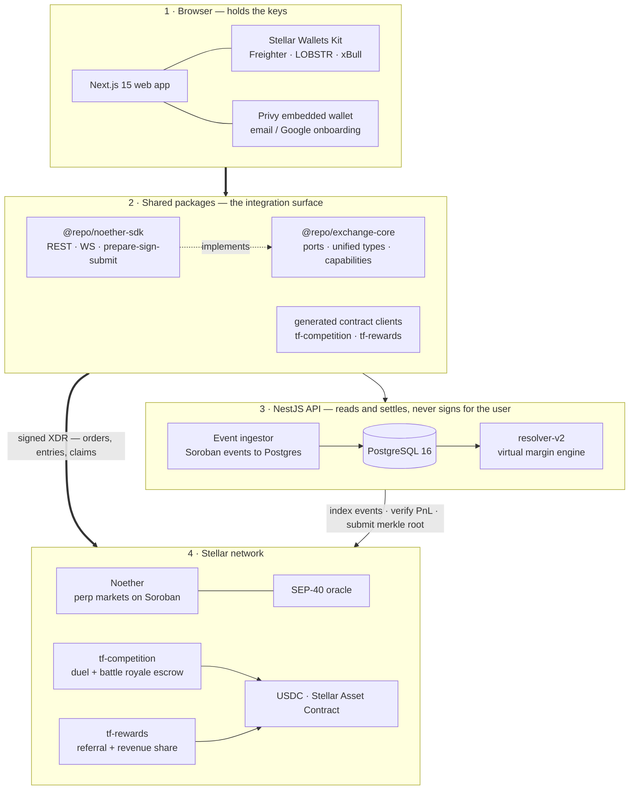
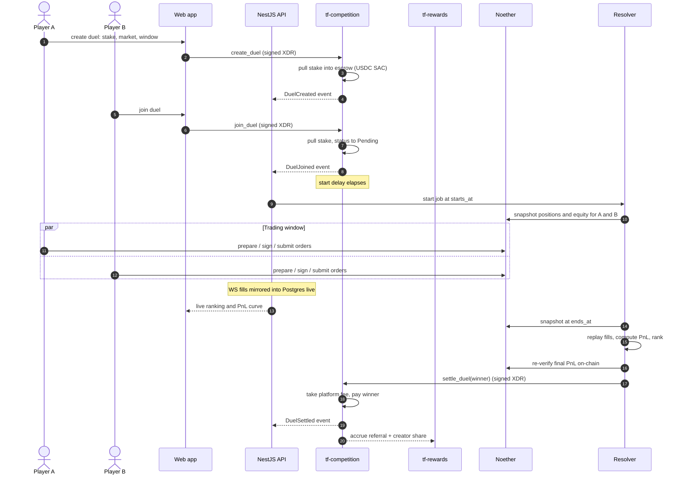
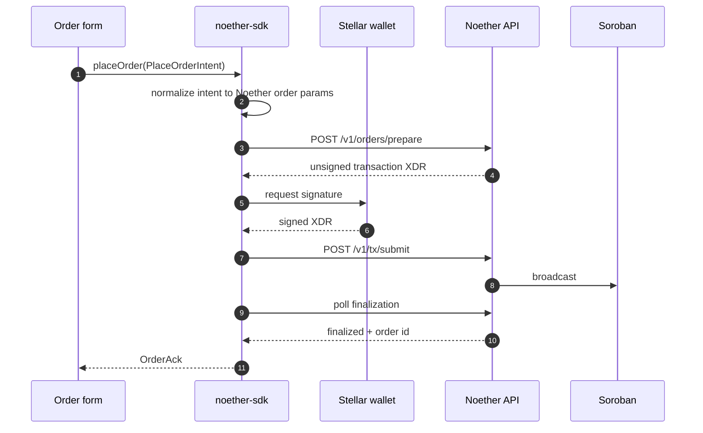
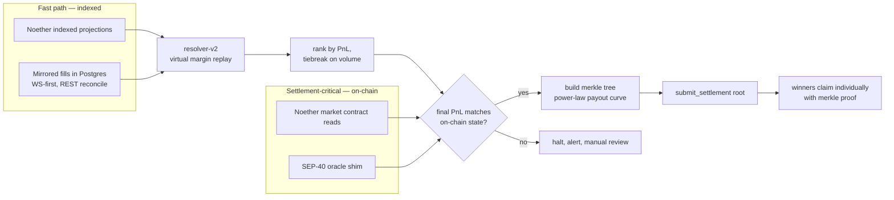

# TF-Stellar

**The competitive & social layer for perpetuals — on Stellar.**

This repository holds the Stellar/Soroban side of [TradeFighters](https://tradefighters.fun):
two Soroban smart contracts (`tf-competition`, `tf-rewards`), the generated
TypeScript clients the product consumes, and the technical architecture for the
Noether integration.

> **Status:** `tf-competition` runs 1v1 duels (create / join / cancel /
> settle) with USDC escrow, tested in CI and deployed on Stellar testnet
> (see [Testnet deployment](#testnet-deployment)). Battle royales, merkle
> claims and `tf-rewards` come next. Contracts are
> specified in [`docs/CONTRACTS.md`](docs/CONTRACTS.md) and delivered against
> [`docs/ROADMAP.md`](docs/ROADMAP.md). Everything in this repository is
> MIT-licensed so other Stellar builders can reuse the escrow +
> merkle-distribution and on-chain revenue-share patterns.

## Build and test

Requires Rust (the version comes from `rust-toolchain.toml`) and
[`stellar-cli`](https://github.com/stellar/stellar-cli) 28.1.0.

```sh
make check   # fmt + clippy + unit tests + WASM build, same as CI
make test    # cargo test
make build   # stellar contract build -> target/wasm32v1-none/release/*.wasm
```

Pinned versions, testnet addresses (USDC SAC) and the deploy command:
[`docs/SOROBAN-SETUP.md`](docs/SOROBAN-SETUP.md).

## Testnet deployment

`tf-competition` is live on Stellar testnet, holding Circle's testnet USDC:

| | |
| --- | --- |
| Contract | [`CBQB5S2RCMLO7ZX2CP3CBPCOJZIYVY5AZAZIWP2KAFYJ2BNBRRZOJQXE`](https://stellar.expert/explorer/testnet/contract/CBQB5S2RCMLO7ZX2CP3CBPCOJZIYVY5AZAZIWP2KAFYJ2BNBRRZOJQXE) |
| USDC (SAC) | [`CBIELTK6YBZJU5UP2WWQEUCYKLPU6AUNZ2BQ4WWFEIE3USCIHMXQDAMA`](https://stellar.expert/explorer/testnet/contract/CBIELTK6YBZJU5UP2WWQEUCYKLPU6AUNZ2BQ4WWFEIE3USCIHMXQDAMA) |
| Config | platform fee 5 %, stake 1 – 1 000 USDC, start at least 60 s after creation |

Demo transactions (a win, a draw and a cancellation), produced by
[`scripts/testnet-demo.sh`](scripts/testnet-demo.sh). Each transaction page
shows the contract events (`duel_created`, `duel_joined`, `duel_settled`,
`duel_payout`, `duel_cancelled`) and the USDC transfers.

| Step | Transaction |
| --- | --- |
| deploy `tf-competition` (constructor sets the config) | [`538823d93a22…`](https://stellar.expert/explorer/testnet/tx/538823d93a222c4f2444c2739224ea4afcdf90dba7c6fa5eb48f2b057ff5b08e) |
| duel 3: `create_duel` — player A stakes 10 USDC | [`ee14edbc0729…`](https://stellar.expert/explorer/testnet/tx/ee14edbc072900e7388a82d9f5ad948841c4108ce94e4b5cb0e1184354a863df) |
| duel 3: `join_duel` — player B stakes 10 USDC | [`bb511e7a365d…`](https://stellar.expert/explorer/testnet/tx/bb511e7a365d657b487abe562d1b2f18f894ff5e8964ab382a1881ba82f56f60) |
| duel 3: `settle_duel Win(A)` — A gets 19 USDC, treasury 1 USDC | [`bf8ebe3a5e83…`](https://stellar.expert/explorer/testnet/tx/bf8ebe3a5e8366d1516582386b230279ae06b79b2fb42085b29ab046b98b47cd) |
| duel 4: `create_duel` — player A stakes 10 USDC | [`7f5a6910d6d0…`](https://stellar.expert/explorer/testnet/tx/7f5a6910d6d018fd57a443c1a39b8eec1b4cd2f80fac33eee35ee6c1646879e2) |
| duel 4: `join_duel` — player B stakes 10 USDC | [`666aeeff8145…`](https://stellar.expert/explorer/testnet/tx/666aeeff8145b8e22c517a7567f73fe1f28ab6b056fa5329c540c26f34845f4b) |
| duel 4: `settle_duel Draw` — 9.5 USDC back to each, treasury 1 USDC | [`336240c850aa…`](https://stellar.expert/explorer/testnet/tx/336240c850aa80629c4895011a790086f32a91ebae193c55dd899b80aa919c5d) |
| duel 5: `create_duel` — player A stakes 10 USDC | [`fda8d459a124…`](https://stellar.expert/explorer/testnet/tx/fda8d459a124894042be0e60d659c10197d9645a6af0ff2acd28a6dceb3cc7d2) |
| duel 5: `cancel_duel` by the creator — 10 USDC refunded | [`bded91663c85…`](https://stellar.expert/explorer/testnet/tx/bded91663c85e623cfa204f82301d85b92b96685987eef8e0fd51d19903c3876) |

After these three duels the escrow holds 0 USDC and the treasury holds the
3 USDC of fees.

---

## What TradeFighters is

TradeFighters turns perpetual futures trading into a skill-based sport. Users
stake USDC to enter **1v1 duels** or multi-player **battle royales**, trade real
perp markets for a fixed window, and the winners are paid out of an on-chain
escrow — ranked by verified, reconstructed on-chain performance rather than
screenshots.

It runs today in closed beta on Solana with a multi-exchange backend
(Pacifica, Hyperliquid, Phoenix) behind a single ports-and-adapters contract
layer. This repository is how that whole product comes to Stellar.

## Why this is an integration, not a greenfield build

The product monorepo (Next.js 15 / React 19 web, NestJS 11 API, PostgreSQL 16 +
Prisma) is already exchange-agnostic. A package called `@repo/exchange-core`
defines the port interfaces — `MarketDataPort`, `AccountDataPort`,
`TradingPort`, `StreamPort` — plus unified domain types and per-venue
capability flags. Each venue is an adapter implementing those ports. Three
adapters ship in production today.

The settlement engine (`resolver-v2`) is likewise venue-neutral: it is a
virtual margin engine that replays normalized fills against candle series, and
already supports merged multi-exchange replay via symbol namespacing.

So the Stellar work slots into interfaces that already run real competitions:

| Layer | Exists today | What Stellar adds |
| --- | --- | --- |
| Exchange ports | `@repo/exchange-core` | `@repo/noether-sdk` — a fourth adapter |
| Bridging ports | `@repo/bridge-core` (`BridgePort`) | Stellar as a bridge destination chain |
| Escrow & prizes | Anchor program on Solana | `tf-competition` on Soroban |
| Referral / rev-share | off-chain accounting | `tf-rewards` on Soroban, claimable |
| Auth | wallet adapter + Privy embedded | Stellar Wallets Kit + Privy |

---

## System architecture



Two rules that shape everything below:

1. **No private key ever touches our servers.** Every state-changing
   transaction is prepared unsigned, signed by the user's wallet in the
   browser, and submitted as XDR.
2. **Settlement reads on-chain truth.** The resolver may use indexed
   projections for speed, but the final PnL that decides who gets paid is
   re-verified against Soroban contract reads before a merkle root is
   submitted.

---

## Repository layout

```
TF-stellar/
├── Cargo.toml                  # Soroban workspace (Rust), soroban-sdk 29
├── contracts/
│   ├── tf-competition/         # duel + battle royale escrow, merkle payouts
│   └── tf-rewards/             # (tranche 1) referral bindings, fee accrual, claims
├── packages/                   # (tranche 1) generated typed TS clients
│   ├── tf-competition-client/
│   └── tf-rewards-client/
├── .github/workflows/ci.yml    # fmt, clippy, tests, WASM build on every push
└── docs/
    ├── ARCHITECTURE.md         # full technical architecture + diagrams
    ├── CONTRACTS.md            # contract specs, storage, state machines
    ├── SOROBAN-SETUP.md        # pinned versions, addresses, build/deploy commands
    ├── NOETHER-ADAPTER.md      # @repo/noether-sdk design
    ├── ONBOARDING.md           # wallets, auth, bridge + swap funding
    └── ROADMAP.md              # tranche deliverables and acceptance criteria
```

The contract workspace follows the layout `stellar contract init` generates.
TS clients come from `stellar contract bindings typescript`; Stellar Registry
publishing (so third parties can instantiate the contracts by name) is planned
for mainnet.

---

## The five workstreams

### 1. `@repo/noether-sdk` — Noether protocol adapter

A TypeScript package implementing the `exchange-core` ports against
[Noether](https://docs.noether.exchange), the perps protocol on Soroban.
REST client for `/v1` (markets, oracle, accounts, positions, trading, vaults,
referral) and a WebSocket client for ticks and trade events, structured exactly
like the existing Pacifica and Hyperliquid SDKs.

Details: [`docs/NOETHER-ADAPTER.md`](docs/NOETHER-ADAPTER.md).

### 2. Soroban contracts

`tf-competition` ports the escrow and prize logic; `tf-rewards` is new and
handles referral bindings and revenue sharing. Both hold value in USDC through
the Stellar Asset Contract interface, with checked arithmetic on every path.

Details: [`docs/CONTRACTS.md`](docs/CONTRACTS.md).

### 3. Wallet and auth

Stellar Wallets Kit alongside the existing dual-auth. One signing ceremony
covers session login *and* Noether API-key provisioning.

### 4. Funding: bridge + swap

Rather than write custody-critical bridge code, an established bridge (e.g.
Allbridge) and a Stellar AMM (e.g. Soroswap) are wrapped behind a single
deposit widget. The bridge side implements the existing `BridgePort` contract
from `@repo/bridge-core`, adding Stellar as a destination chain.

Details for 3 and 4: [`docs/ONBOARDING.md`](docs/ONBOARDING.md).

### 5. Backend: indexing and settlement

A Stellar module in the NestJS API with Soroban RPC + Horizon clients, an event
ingestor streaming `tf-competition` and `tf-rewards` events into Postgres, and
the existing resolver retargeted at Soroban.

---

## Competition lifecycle

A 1v1 duel end-to-end. Battle royales follow the same shape with N players and
a merkle root instead of a single winner.



Outcomes `settle_duel` handles: **win** (winner takes pool minus fee),
**draw** (each player gets their stake back minus half the fee) and **issue**
(the duel couldn't be scored: both stakes back in full). An unjoined duel, or
a joined one before its start, is closed with `cancel_duel` and refunded in full.

---

## Non-custodial order flow

Noether's prepare–sign–submit pattern is what keeps trading non-custodial. The
adapter never holds a key; it orchestrates.



The same shape covers cancels, leverage changes, and TP/SL — each is an intent
in, a signed XDR out, an `OrderAck` back.

---

## Settlement and reconciliation

The part reviewers should look at hardest: how money is decided.



Winners claim rather than get pushed: settlement writes one 32-byte root, and
each winner submits a proof. Claim receipts stored per `(competition, winner)`
make double-claims impossible.

---

## Roadmap

| Tranche | Deliverables | Target |
| --- | --- | --- |
| **1 — MVP** | Soroban contracts on testnet · Noether adapter + Stellar wallet auth · full duel loop on testnet | Dec 2026 – Jan 2027 |
| **2 — Testnet** | Battle royales + `tf-rewards` live · bridge/swap deposit widget · audit-readiness pack | Feb – Mar 2027 |
| **3 — Mainnet** | Mainnet deploy + Registry publish · production infra and runbooks · open-source SDK + docs | Apr – May 2027 |

Acceptance criteria per deliverable are in [`docs/ROADMAP.md`](docs/ROADMAP.md).

---

## Ecosystem building blocks used

[Scaffold Stellar](https://github.com/AhaLabs/scaffold-stellar) ·
[Stellar Wallets Kit](https://stellarwalletskit.dev) ·
[Privy](https://privy.io) ·
[Soroswap](https://soroswap.finance) ·
[Allbridge](https://allbridge.io) ·
[Anchor Platform](https://developers.stellar.org/docs/tools/developer-tools/anchor-platform)

## License

MIT — see [LICENSE](LICENSE).
