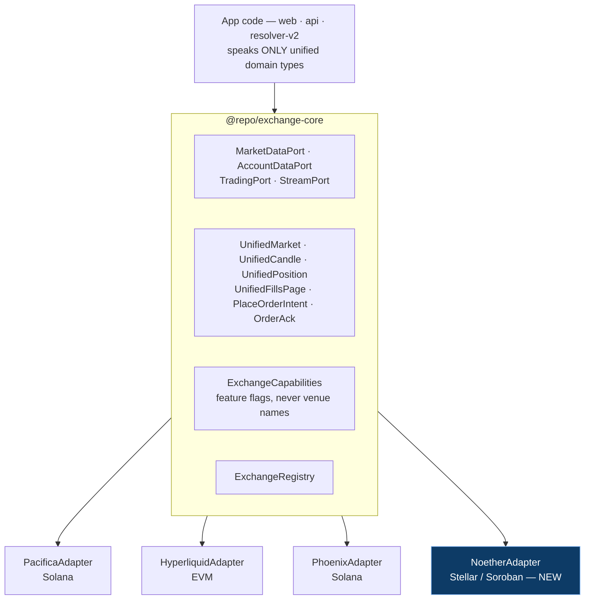
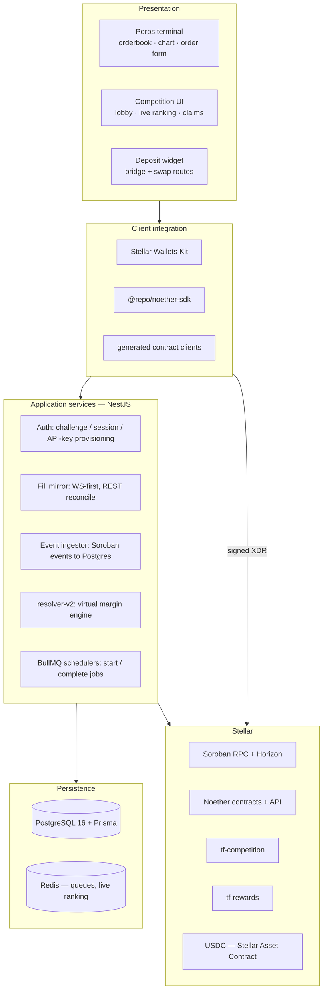
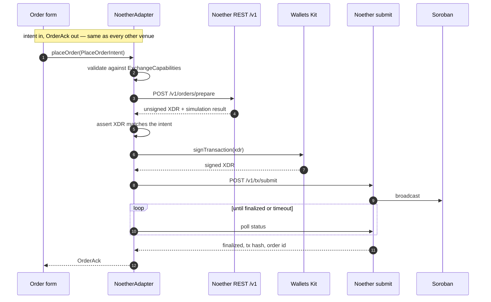
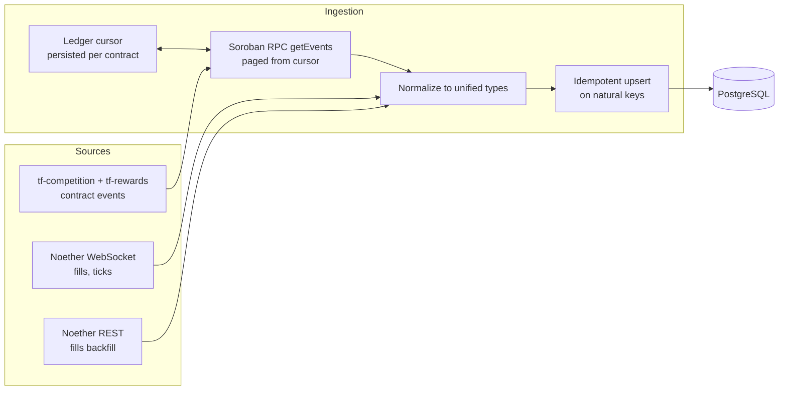
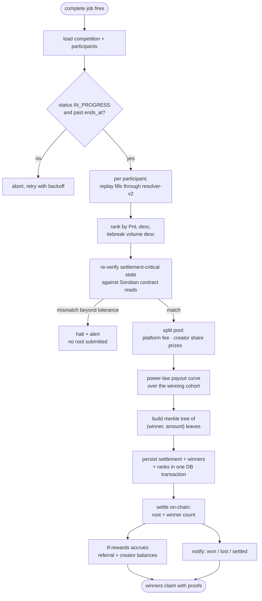
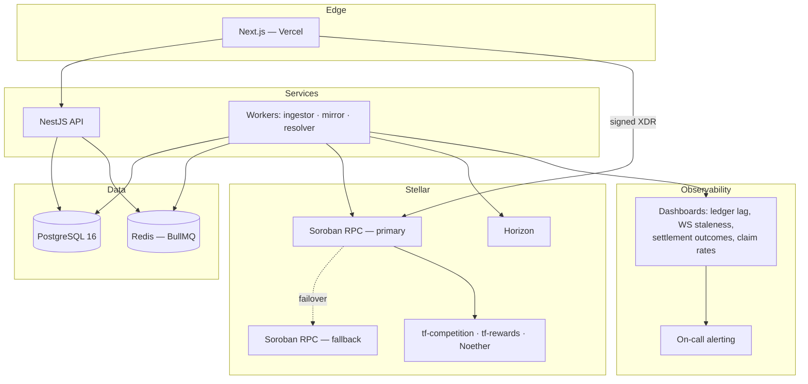

# Technical Architecture

How the TradeFighters product — already running competitions in production —
extends onto Stellar. This document covers the layering, the runtime flows, the
data model, and the failure handling. Contract internals live in
[CONTRACTS.md](CONTRACTS.md); the exchange adapter in
[NOETHER-ADAPTER.md](NOETHER-ADAPTER.md).

## Contents

1. [Existing foundation](#1-existing-foundation)
2. [Layered view](#2-layered-view)
3. [Trading path](#3-trading-path)
4. [Indexing path](#4-indexing-path)
5. [Settlement path](#5-settlement-path)
6. [Identity model](#6-identity-model)
7. [Deployment topology](#7-deployment-topology)
8. [Failure modes](#8-failure-modes)

---

## 1. Existing foundation

The product monorepo is a Turborepo workspace: Next.js 15 / React 19 web app,
NestJS 11 API, PostgreSQL 16 with Prisma. Its multi-exchange design is
hexagonal — application code speaks only unified domain types, and each venue
is an adapter behind a port.

Four principles carry over unchanged:

1. **Unified domain types at the boundary.** Adapters normalize wire formats
   once, at the edge. Decimal-string amounts, epoch-ms timestamps, symbols
   scoped per exchange and compared as `(exchange, symbol)`.
2. **Capability flags, not a lowest common denominator.** Each adapter
   publishes an `ExchangeCapabilities` descriptor — combined TP/SL orders?
   TP triggers? candle caps? fill retention depth? App code branches on flags.
   Adding Noether means adding a descriptor, not `if (exchange === ...)`.
3. **Adapters own signing end-to-end.** Callers send intents; the adapter picks
   the signer and the wire mechanics. Pacifica uses sorted-JSON ed25519,
   Hyperliquid uses EIP-712 agent keys, Noether uses signed Soroban XDR.
4. **One composition root per app.** The API's global `ExchangeModule` builds
   the registry with every adapter; consumers inject the registry.

Adding Stellar therefore means: one adapter package, one capability descriptor,
one `ExchangeId`, and two new contracts — not a fork of the product.

### What has to change outside the adapter

| Concern | Change |
| --- | --- |
| `ExchangeId` | add `'noether'` to `EXCHANGE_IDS`; mirror `NOETHER` in the Prisma `Exchange` enum |
| `ExchangeChainType` | add `'stellar'` alongside `'solana' \| 'evm'` |
| Trading identity | `user_exchange_accounts` gains Stellar addresses (G...) |
| Competition gating | `duels.allowed_exchanges` / `tournaments.allowed_exchanges` accept `NOETHER` |
| Escrow | competition rows carry a chain discriminator: Solana program vs `tf-competition` |

Because trading addresses are format-disjoint across chains (base58 vs `0x`
vs `G...`), the mirrored-fills table's `(account, history_id)` uniqueness stays
valid with no schema surgery.

---

## 2. Layered view

The client talks to Stellar directly for anything requiring a signature. The
API never proxies a signing request — it only reads, indexes, and submits its
own operator-signed settlement transactions.

---

## 3. Trading path

Noether exposes a prepare–sign–submit flow so that the venue builds the
transaction and the user authorizes it. The adapter is the orchestrator.

Step 4 is not decoration. Before a user is asked to sign, the adapter decodes
the returned XDR and asserts that the invoked contract, market, side, size, and
price bounds match the intent that produced it. A venue that returns a
different transaction than requested must fail closed, not get signed.

### Streams

The WebSocket client reuses the realtime resilience layer built for the
existing venues: a staleness watchdog that treats "connected but silent" as
failure, wake-from-sleep recovery, unbounded reconnect with backoff, a
snapshot replay flagged `isSnapshot: true` after each reconnect, and a
stale-data badge in the UI when ticks age past threshold.

---

## 4. Indexing path

Two independent ingest streams feed Postgres: contract events for competition
state, and trading fills for PnL.

Design notes:

- **Cursor-driven, replayable.** The ingestor stores the last processed ledger
  sequence per contract. A restart resumes from the cursor; a forced replay
  rewinds it. Every write is an idempotent upsert on a natural key
  (`(contract, ledger, event_index)` for events, `(account, history_id)` for
  fills), so replay converges instead of duplicating.
- **WS-first, REST-reconcile.** The WebSocket gives low latency for live
  rankings; a periodic REST sweep over the competition window catches anything
  the socket dropped. This is the same two-source pattern the Hyperliquid fill
  mirror already uses in production.
- **Retention awareness.** `capabilities.fillHistoryDepth` tells the resolver
  how far back Noether's fill history reaches, so a window that predates the
  retention horizon is flagged rather than silently truncated.

---

## 5. Settlement path

The settlement pipeline is scheduled, not polled: creating a competition
schedules a start job at `starts_at` and a complete job shortly after
`ends_at`, giving in-flight fills time to land.

### Why the engine needed no changes

`resolver-v2` is a **virtual margin engine**. It simulates an account from a
configured start capital and never reads real account equity, so every
competitor is scored on identical terms regardless of what they hold outside
the competition. Multi-venue support is therefore an *input* problem, already
solved by symbol namespacing: with `namespaceSymbols: true`, positions,
margin, and candle series are keyed `exchange:symbol`, so a single virtual
account can hold `noether:BTC` and `hyperliquid:BTC` as distinct positions
inside one competition.

Adding Noether means supplying two things the existing builders already accept:
normalized `ResolverFill`s and a candle series per traded symbol. If Noether
exposes mark-price candles, they are used; otherwise the engine falls back to
trade candles, exactly as it does for venues without mark-price support.

### The verification gate

The step labelled `XCHK` is the trust boundary. Indexed projections are used
for speed everywhere except the number that decides payouts. Before any root is
submitted, final per-competitor PnL is recomputed from direct Soroban reads —
market contract state plus the SEP-40 oracle shim — and compared against the
replayed figure. Beyond tolerance, the pipeline halts and pages a human. It
never guesses, and it never settles from indexer data alone.

---

## 6. Identity model

A user has one trading identity per venue. Stellar adds a third address column
and a fourth signing scheme.

| | Pacifica | Hyperliquid | Noether |
| --- | --- | --- | --- |
| Chain family | Solana | EVM | Stellar |
| Trading address | Solana pubkey | `0x…` | `G…` |
| Wallet origin | wallet adapter or Privy embedded Solana | Privy embedded Ethereum | Stellar Wallets Kit or Privy |
| Signing | browser wallet / session signer | delegated agent key | browser wallet, signed XDR |
| Custody | non-custodial | delegated agent | non-custodial |

`user_exchange_accounts` stays the canonical `(user, exchange) → tradingAddress`
table, gaining Stellar rows with a per-exchange `is_initialized` flag.

Notably, Noether is the **more** non-custodial of the three: unlike the
Hyperliquid path, no server-held key signs on the user's behalf. Every order
requires a wallet signature.

---

## 7. Deployment topology

Environments: local (Scaffold Stellar watch mode against a local network),
testnet (public staging), mainnet. Contract addresses are configuration, never
compiled constants, so one build targets any network.

---

## 8. Failure modes

| Failure | Detection | Response |
| --- | --- | --- |
| Soroban RPC degraded | health probe, ledger lag threshold | fail over to secondary; ingestor resumes from cursor |
| WebSocket connected but silent | staleness watchdog | force reconnect, snapshot replay, stale badge in UI |
| Missed contract events | cursor gap check on ledger sequence | rewind cursor and replay; upserts are idempotent |
| Indexed PnL disagrees with chain | verification gate before settlement | halt, alert, no root submitted |
| Settlement transaction fails | submit + finalization polling | retry with backoff; settlement is idempotent per competition |
| Competition never gets a second player | start job validation | cancel path returns the creator's stake |
| Winner never claims | claim-rate dashboard | funds stay in escrow, claimable; no forced push |
| Double-claim attempt | claim receipt per `(competition, winner)` | contract rejects |

Two invariants make most of this recoverable: the ingestor is replayable
because writes are idempotent, and settlement is idempotent per competition
because the root is written once and claims are gated by receipts.
