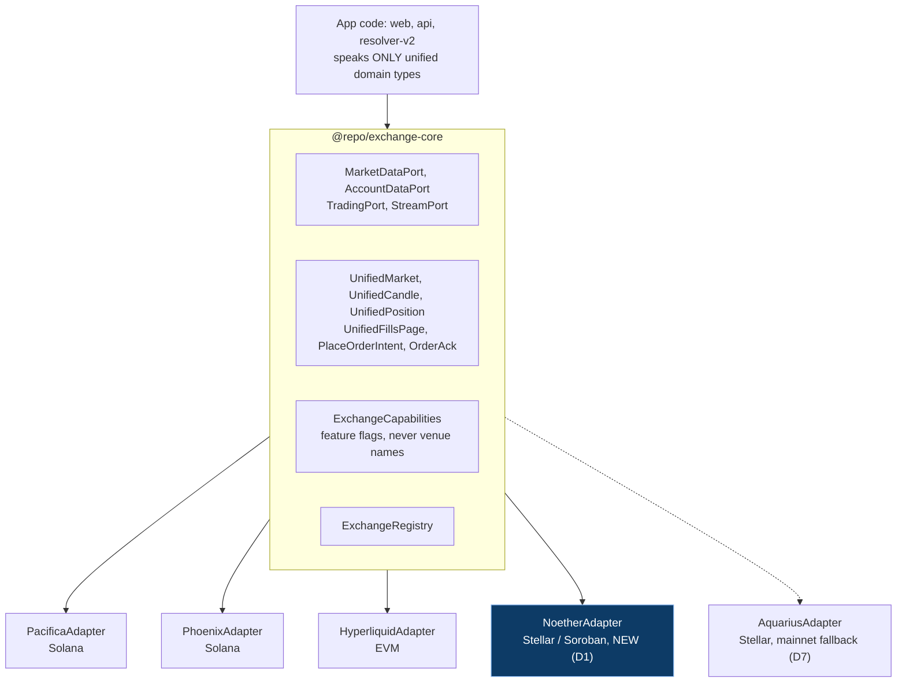
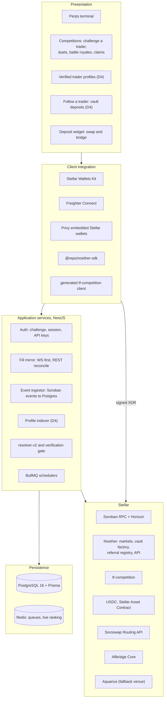
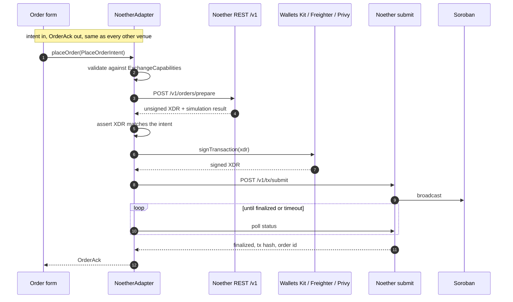
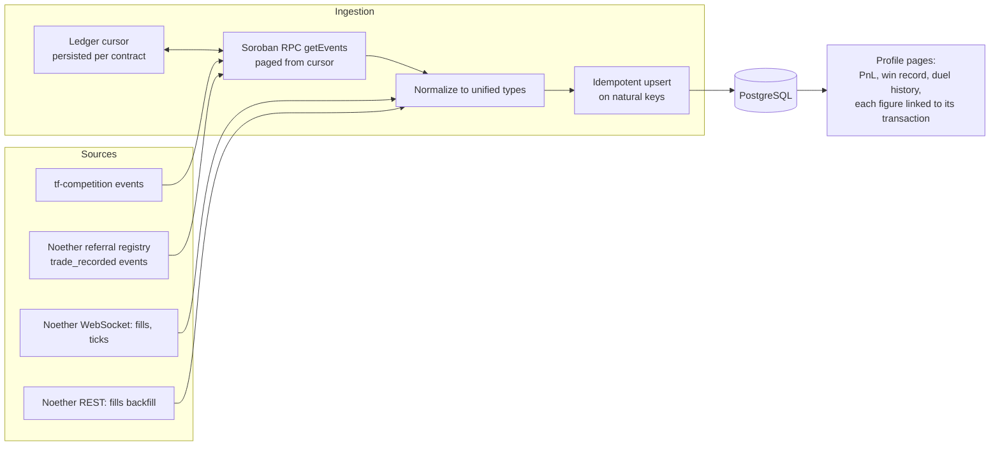
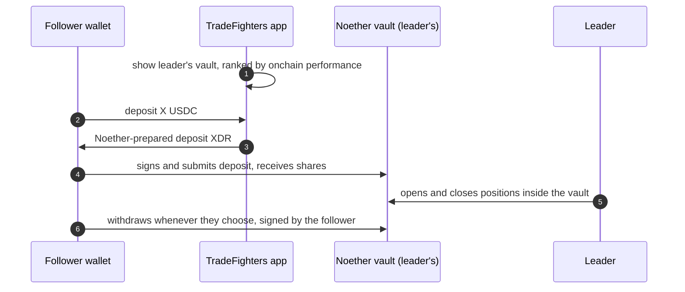
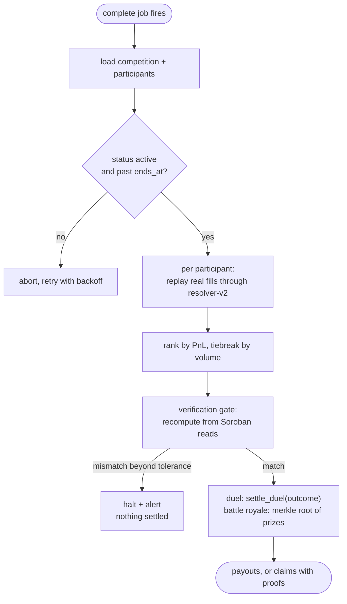
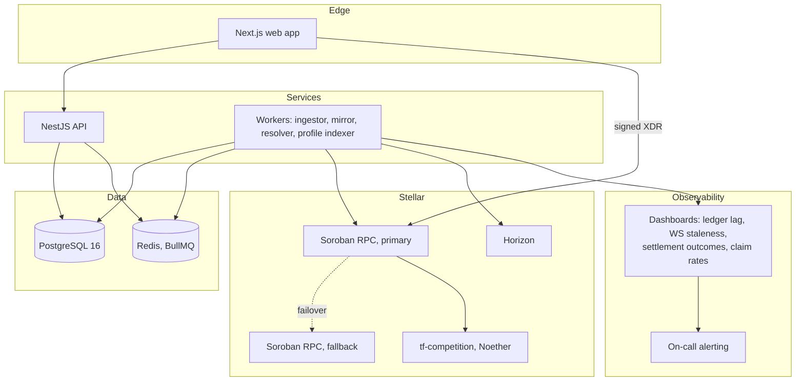

# Technical Architecture

How TradeFighters, the social network for on-chain traders, extends onto
Stellar. This document matches our SCF #46 Build submission number for number:
9 deliverables, 920 engineering hours, $82,800, mainnet in March 2027.
Contract internals live in [CONTRACTS.md](CONTRACTS.md), the exchange adapter
in [NOETHER-ADAPTER.md](NOETHER-ADAPTER.md), wallet and deposit flows in
[ONBOARDING.md](ONBOARDING.md), acceptance criteria per deliverable in
[ROADMAP.md](ROADMAP.md).

## Contents

0. [Scope at a glance](#0-scope-at-a-glance)
1. [Existing foundation](#1-existing-foundation)
2. [Layered view](#2-layered-view)
3. [Stellar building blocks](#3-stellar-building-blocks)
4. [Trading path](#4-trading-path)
5. [Noether status and venue contingency](#5-noether-status-and-venue-contingency)
6. [Indexing path and verified profiles](#6-indexing-path-and-verified-profiles)
7. [Following a trader through Noether vaults](#7-following-a-trader-through-noether-vaults)
8. [Settlement path](#8-settlement-path)
9. [Settlement trust model](#9-settlement-trust-model)
10. [Onchain footprint and final-tranche metric](#10-onchain-footprint-and-final-tranche-metric)
11. [Deployment topology](#11-deployment-topology)
12. [Failure modes](#12-failure-modes)

---

## 0. Scope at a glance

### Already built (self-funded, not in the award budget)

| What | Where | Evidence |
| --- | --- | --- |
| TradeFighters platform: Next.js web app, NestJS API, PostgreSQL, venue adapters for Pacifica, Phoenix and Hyperliquid | product monorepo | live product |
| Competition escrow on Solana (duels and battle royales, 5% platform fee) | Anchor program `TFrXd1Fm4FoWdhzqm7qxL7dD8yqzDw3kf8Cjt9gVgZx` | 347 transactions, April to August 2026: 25 competitions settled, $3,490 of entry fees from 37 paying users, [explorer](https://explorer.solana.com/address/TFrXd1Fm4FoWdhzqm7qxL7dD8yqzDw3kf8Cjt9gVgZx) |
| `tf-competition` 1v1 duel escrow on Soroban: create, join, cancel, settle | this repository | testnet contract `CBQB5S2RCMLO7ZX2CP3CBPCOJZIYVY5AZAZIWP2KAFYJ2BNBRRZOJQXE`, 25 unit tests, 9 demo transactions in the [README](../README.md#testnet-deployment) |

### Funded by the award

| # | Deliverable | Tranche | Hours | Budget | Stellar building block |
| --- | --- | --- | --- | --- | --- |
| D1 | Noether adapter | 1, MVP | 120 | $10,800 | Noether (ecosystem protocol) |
| D2 | Stellar onboarding: wallets and swap to USDC | 1, MVP | 130 | $11,700 | Stellar Wallets Kit, Freighter Connect, Privy, Soroswap |
| D3 | Challenge-a-trader duel loop on testnet | 1, MVP | 100 | $9,000 | Soroban, USDC (SAC) |
| D4 | Social layer: verified trader profiles and following a trader through Noether vaults | 2, Testnet | 170 | $15,300 | Soroban events, Noether vault factory |
| D5 | Battle royale on public testnet | 2, Testnet | 120 | $10,800 | Soroban, Noether referral registry |
| D6 | Threat model and monitoring plan | 2, Testnet | 60 | $5,400 | Soroban events |
| D7 | Mainnet launch | 3, Mainnet | 120 | $10,800 | Noether, Aquarius as fallback venue |
| D8 | Allbridge Core inbound USDC | 3, Mainnet | 60 | $5,400 | Allbridge |
| D9 | Open-source release | 3, Mainnet | 40 | $3,600 | |
| | **Total** | | **920** | **$82,800** | |

Blended rate $90/h. Tranche 1: 350 h, $31,500. Tranche 2: 350 h, $31,500.
Tranche 3: 220 h, $19,800. Engineering is led by Jérémie Lucotte, author of
`tf-competition`, with two engineers working on the deliverables in parallel.

### Not funded by the award

The social feed, live streams and wallet analytics across Solana DEXs, prizes,
referral and creator incentives, marketing and user acquisition, legal and
entity costs. The security audit is requested separately through the Soroban
Security Audit Bank.

---

## 1. Existing foundation

The product monorepo is a Turborepo workspace: Next.js 15 / React 19 web app,
NestJS 11 API, PostgreSQL 16 with Prisma. Its multi-exchange design is
hexagonal: application code speaks only unified domain types, and each venue is
an adapter behind a port.

Four principles carry over unchanged:

1. **Unified domain types at the boundary.** Adapters normalize wire formats
   once, at the edge: decimal-string amounts, epoch-ms timestamps, symbols
   scoped per exchange and compared as `(exchange, symbol)`.
2. **Capability flags, not a lowest common denominator.** Each adapter
   publishes an `ExchangeCapabilities` descriptor. Adding Noether means adding a
   descriptor, not `if (exchange === ...)`.
3. **Adapters own signing end to end.** Callers send intents; the adapter picks
   the signer and the wire mechanics. Noether uses signed Soroban XDR.
4. **One composition root per app.** The API's global `ExchangeModule` builds
   the registry with every adapter; consumers inject the registry.

### Attribution, the lesson of our first platform

On our first platform, part of the orders routed through our interface reached
Pacifica and Phoenix without our builder and referral codes attached, because
of a configuration error on our side. That volume happened on our app but
cannot be attributed to us onchain. Two rules follow:

- **Every routed order carries our code.** In V2 the configuration is
  corrected, and each venue adapter treats the builder and referral fields as
  required rather than optional.
- **On Stellar, attribution is onchain by construction.** Every TradeFighters
  user is bound to the TradeFighters code in Noether's referral registry, whose
  `trade_recorded` events attribute volume to us without relying on our own
  database (section 6).

### What changes outside the adapter

| Concern | Change |
| --- | --- |
| `ExchangeId` | add `'noether'` to `EXCHANGE_IDS`; mirror `NOETHER` in the Prisma `Exchange` enum |
| `ExchangeChainType` | add `'stellar'` alongside `'solana' \| 'evm'` |
| Trading identity | `user_exchange_accounts` gains Stellar addresses (G...) |
| Competition gating | `duels.allowed_exchanges` / `tournaments.allowed_exchanges` accept `NOETHER` |
| Escrow | competition rows carry a chain discriminator: Solana program or `tf-competition` |

---

## 2. Layered view

The client talks to Stellar directly for anything requiring a user signature.
The API never proxies a user signing request: it reads, indexes, and submits
only the resolver's settlement transactions.

---

## 3. Stellar building blocks

Every Integration List item named in the submission has its own deliverable,
its own budget line and a place in this document.

| Block | Integration List | What we use it for | Deliverable | Budget |
| --- | --- | --- | --- | --- |
| Stellar Wallets Kit | yes | multi-wallet connection (xBull, LOBSTR and others) | D2 | $900 |
| Freighter Connect | yes | Freighter-specific flows the escrow needs: Soroban authorization entries signed with `signAuthEntry` when a player joins, network mismatch detection, account change handling | D2 | $4,000 |
| Privy | yes | email sign-in with embedded Stellar wallets | D2 | $1,400 |
| Soroswap | yes | Routing API: swap XLM or other Stellar assets into USDC in the deposit widget | D2 | $5,400 |
| Allbridge Core | yes | inbound USDC from other chains, landing as Stellar USDC | D8 | $5,400 |
| Aquarius | yes | named mainnet fallback venue for competitions (section 5) | D7 | within D7 |
| Noether | no, ecosystem protocol | perpetual futures venue, vault factory, referral registry | D1, D3, D4, D5, D7 | |

Details of the wallet and deposit flows: [ONBOARDING.md](ONBOARDING.md). Fiat
on-ramps are out of scope for this award.

---

## 4. Trading path

Noether exposes a prepare, sign, submit flow: the venue builds the transaction
and the user authorizes it. The adapter is the orchestrator.

Before a user is asked to sign, the adapter decodes the returned XDR and asserts
that the invoked contract, market, side, size and price bounds match the intent
that produced it. A venue that returns a different transaction than requested
fails closed. Noether contract addresses are read from `GET /v1/health`, never
hardcoded.

---

## 5. Noether status and venue contingency

Noether is the perpetual futures exchange on Soroban. It is not on the SCF
Integration List; this submission also integrates five listed blocks
(section 3).

**Status at the time of writing (November 2026)**: testnet live; mainnet contracts
deployed in guarded mode on 3 October 2026, with trading opening after
Noether's independent audit.

**How our delivery stays independent of Noether's schedule:**

- **Tranches 1 and 2 run entirely on Noether testnet**, which is public and
  permissionless. No deliverable waits for an approval from Noether.
- **`tf-competition` never calls the venue.** It receives an outcome from the
  resolver; the resolver reads PnL through a venue adapter. Changing venue means
  changing adapter, not contract.
- **Mainnet fallback: Aquarius.** If Noether mainnet trading is not open within
  the tranche 3 window, competitions run as spot trading competitions on
  Aquarius, an Integration List item already live on mainnet.
- **The final-tranche metric has a path that depends only on our contract**
  (section 10).

---

## 6. Indexing path and verified profiles

Three ingest streams feed Postgres: our contract events, Noether trading data,
and Noether referral attribution.

- **Cursor-driven, replayable.** The ingestor stores the last processed ledger
  per contract. A restart resumes from the cursor; a forced replay rewinds it.
  Every write is an idempotent upsert on a natural key
  (`(contract, ledger, event_index)` for events, `(account, history_id)` for
  fills), so replay converges instead of duplicating.
- **Verified profiles (D4).** A figure appears on a profile only if it comes
  from a Soroban event or a Noether fill tied to a Stellar account the user has
  linked by signature, and each figure links to its transaction. Rebuilding the
  index from scratch reproduces the same profiles, which is the D4 completion
  test.
- **Attribution.** `trade_recorded` events give, per trade, the referee, the
  referrer (our code), the fee and the volume. This is how volume we bring to
  Noether is counted, for our own dashboards and for the final-tranche metric.

---

## 7. Following a trader through Noether vaults

Copy trading on TradeFighters is non-custodial and runs on Noether's own vault
contracts. A trader who runs a Noether vault gets it displayed on their
profile; a follower deposits into that vault and receives vault shares.

TradeFighters never holds user funds, never holds a key that can move them, and
never places a trade on a user's behalf. The vault's rules (leader permissions,
profit share, withdrawals) are Noether's contract rules, displayed in the app
before any deposit. D4 is completed on Noether testnet.

---

## 8. Settlement path

Creating a competition schedules a start job at `starts_at` and a complete job
shortly after `ends_at`, giving in-flight fills time to land.

**How a competition is scored.** Players trade real markets with their own
wallets. `resolver-v2` replays each player's real fills against a common
starting capital (the `scc` field), so a player with a large account and a
player with a small one are ranked on the same terms: percentage performance,
not account size. The starting capital is a scoring normalization, not
simulated trading.

**Verification gate.** Indexed projections are used for speed everywhere except
the number that decides payouts. Before any settlement, final PnL is recomputed
from direct Soroban reads (Noether market contract state and its oracle) and
compared with the replayed figure. Beyond tolerance, the pipeline halts and
pages a human. It never settles from indexer data alone.

---

## 9. Settlement trust model

What each role can and cannot do, as enforced by `tf-competition` today.

| Role | Can | Cannot |
| --- | --- | --- |
| Player | create a duel, join one, cancel their own duel while no opponent has joined (full refund) | move anyone else's funds |
| Resolver (`config.resolver`) | call `settle_duel` after `ends_at` with one of four outcomes: Win(A), Win(B), Draw, Issue; cancel a duel before trading starts (full refund) | send funds to anyone other than the two players and the treasury; settle before `ends_at` |
| Admin (`config.admin`) | change the config: resolver, treasury, fee bounds, entry fee bounds | move escrowed funds; change the USDC token; change the fee of a duel already created (the fee is stored per duel); set a fee above 20% |
| Treasury | receive the platform fee (5% today) | anything else |

The escrow is the contract itself: no key can withdraw escrowed USDC. Changing
the admin requires both the current and the new admin to sign.

**Key management.**

| Network | Admin | Resolver | Treasury |
| --- | --- | --- | --- |
| Testnet (today) | single key, demo | single key, demo | single key, demo |
| Mainnet (D7) | 2-of-3 Stellar multisig, signers named before mainnet | dedicated hot key on the settlement worker, no other permission | 2-of-3 Stellar multisig |

The residual trust is in the resolver: it decides the outcome. It is bounded by
the four outcomes above, by the verification gate (section 8), and by public
settlement events that anyone can check against Noether's onchain fills.
The full analysis is the D6
STRIDE threat model, with a dataflow diagram and trust boundaries for the
resolver key, admin configuration, profile indexer integrity, vault deposit
flow and embedded wallet keys, and a monitoring plan that maps each
high-severity threat to a contract event and an alert. The security audit is
requested through the Soroban Security Audit Bank.

---

## 10. Onchain footprint and final-tranche metric

Registered at award:

- `tf-competition` mainnet contract ID (deployed in D7)
- resolver account and treasury account
- the TradeFighters code in Noether's referral registry

Final-tranche release condition, measured over the 60 days after the first
mainnet competition, wallets controlled by the team excluded: see the tranche 3
section of [ROADMAP.md](ROADMAP.md#final-tranche-onchain-metric).

---

## 11. Deployment topology

Environments: local (`stellar contract build` against a local network),
testnet (public staging), mainnet. Contract
addresses are configuration, never compiled constants, so one build targets any
network. The workspace keeps the plain `stellar contract init` layout, so
Scaffold Stellar's watch mode and Registry publishing can be layered on later
without moving anything ([SOROBAN-SETUP.md](SOROBAN-SETUP.md#1-toolchain-and-versions)).

---

## 12. Failure modes

| Failure | Detection | Response |
| --- | --- | --- |
| Soroban RPC degraded | health probe, ledger lag threshold | fail over to secondary; ingestor resumes from cursor |
| WebSocket connected but silent | staleness watchdog | force reconnect, snapshot replay, stale badge in UI |
| Missed contract events | cursor gap check on ledger sequence | rewind cursor and replay; upserts are idempotent |
| Indexed PnL disagrees with chain | verification gate before settlement | halt, alert, nothing settled |
| Settlement transaction fails | submit + finalization polling | retry with backoff; settlement is idempotent per competition |
| Competition never gets a second player | start job validation | creator cancels, full refund |
| Order submitted without our code | adapter pre-submit check, per-venue test | order refused, alert |
| Noether mainnet trading not open | venue health check | competitions run on Aquarius |
| Winner never claims | claim-rate dashboard | funds stay in escrow, claimable |
| Double-claim attempt | claim receipt per `(competition, winner)` | contract rejects |
