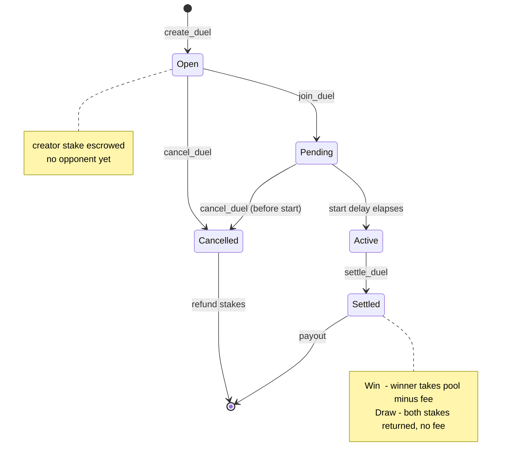
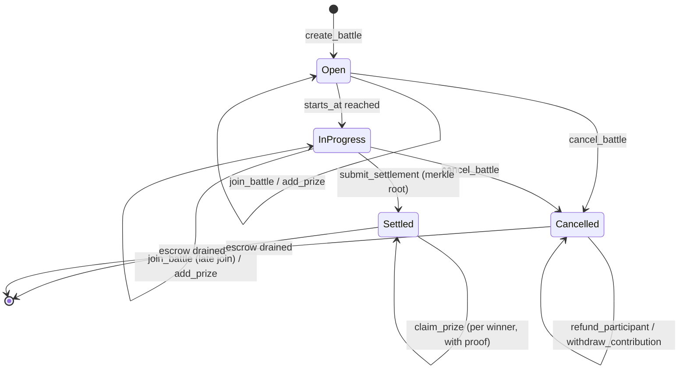
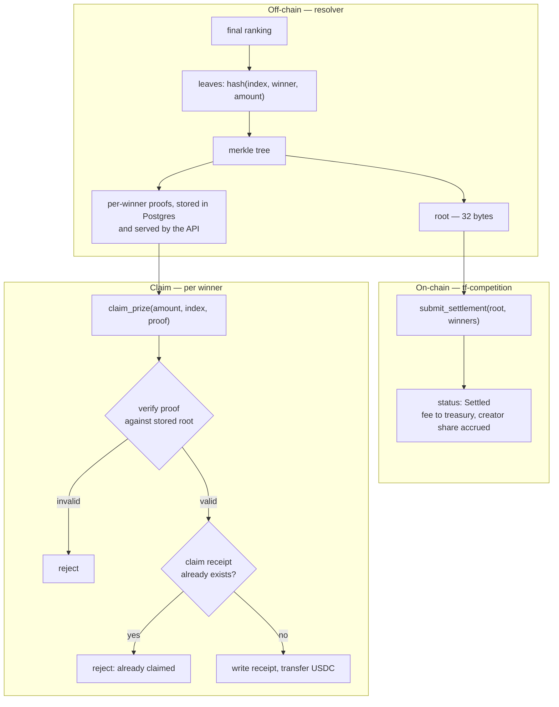
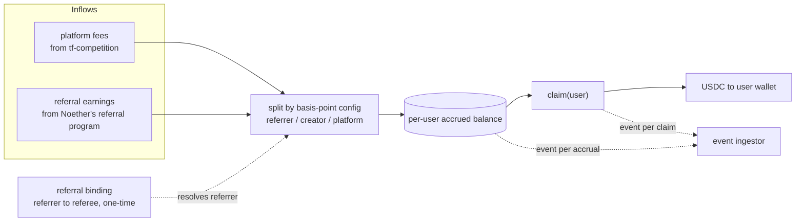

# Soroban Contracts

Two contracts, both holding value in USDC through the Stellar Asset Contract
(SAC) interface:

- **`tf-competition`** — escrow and prize distribution for 1v1 duels and
  multi-player battle royales.
- **`tf-rewards`** — referral bindings and on-chain revenue sharing.

`tf-competition` is a port of a program that has been running competitions in
production on Solana; the security model carries over. `tf-rewards` is new.

---

## Contents

1. [Porting model](#1-porting-model)
2. [tf-competition](#2-tf-competition)
3. [Merkle settlement](#3-merkle-settlement)
4. [tf-rewards](#4-tf-rewards)
5. [Security model](#5-security-model)
6. [Testing strategy](#6-testing-strategy)

---

## 1. Porting model

Solana and Soroban differ most in how state is addressed. The mapping is
mechanical:

| Solana / Anchor | Soroban | Note |
| --- | --- | --- |
| Config PDA | instance storage | one config per deployed instance |
| Per-competition PDA | persistent storage, keyed by competition id | with TTL bumps on every touch |
| Associated token account escrow | contract-held SAC balance | contract address *is* the escrow authority |
| Claim receipt PDA | persistent storage `(competition, claimant)` | same double-claim guarantee |
| SPL token CPI | SAC `transfer` via the token client | `require_auth` on the payer |
| `#[account(mut, has_one = authority)]` | explicit `require_auth(&admin)` | authorization is never implicit |
| Anchor events | `env.events().publish(...)` | consumed by the ingestor |
| Rent-exempt accounts | ledger entry TTL | extend TTL while a competition is live |

Two Soroban specifics the port has to respect and the Anchor original did not:

- **TTL / archival.** Persistent entries expire. Every entrypoint that touches
  a live competition bumps its TTL, and the entry's lifetime is sized to
  outlast the competition window plus the claim period by a wide margin.
- **Authorization is explicit.** There is no account-constraint DSL doing it
  for you. Every entrypoint begins with the `require_auth` calls its
  invariants depend on, and the tests assert the unauthorized case for each.

## 2. tf-competition

### Duel state machine



### Battle royale state machine



Behaviours carried over from the production program:

- **Prize-pool top-ups.** Anyone may add USDC to an unsettled battle. Top-ups
  fold into `total_pool` and are subject to the platform fee like entry fees.
  Contributions are tracked per wallet so they can be refunded individually.
- **Refund on cancel.** A cancelled battle refunds entry fees through the
  participant path and top-ups through the contribution path, each capped at
  what that wallet actually put in — the cap is what prevents a contributor
  from draining the pool.
- **Free entry.** `entry_fee == 0` skips transfers entirely; a free battle can
  still carry a real prize funded by top-ups.
- **Late join.** Players may join any time before `ends_at` while the battle is
  still open, not only before `starts_at`.

### Entrypoints

```rust
// ---- admin ----
fn initialize(env, admin, usdc_sac, treasury, config: Config);
fn set_config(env, config: Config);          // require_auth(admin)
fn set_admin(env, new_admin: Address);       // require_auth(admin)

// ---- duels ----
fn create_duel(env, creator, params: DuelParams) -> u64;
fn join_duel(env, duel_id: u64, player: Address);
fn cancel_duel(env, duel_id: u64);
fn settle_duel(env, duel_id: u64, outcome: DuelOutcome);   // require_auth(resolver)

// ---- battle royales ----
fn create_battle(env, creator, params: BattleParams) -> u64;
fn join_battle(env, battle_id: u64, player: Address);
fn add_prize(env, battle_id: u64, contributor: Address, amount: i128);
fn withdraw_contribution(env, battle_id: u64, contributor: Address, amount: i128);
fn cancel_battle(env, battle_id: u64);
fn refund_participant(env, battle_id: u64, player: Address);
fn submit_settlement(env, battle_id: u64, root: BytesN<32>, winners: u32); // require_auth(resolver)
fn claim_prize(env, battle_id: u64, winner: Address, amount: i128, index: u32, proof: Vec<BytesN<32>>);

// ---- creator fees ----
fn claim_creator_fees(env, creator: Address);
```

### Storage

```rust
// instance
struct Config {
    admin: Address,
    resolver: Address,        // may submit settlements
    treasury: Address,        // receives platform fee
    usdc: Address,            // SAC contract id
    fee_bps: u32,             // platform fee, basis points
    creator_fee_bps: u32,     // creator share of the fee
    min_entry_fee: i128,
    max_entry_fee: i128,
    min_start_delay: u64,     // seconds; time-lock before a competition may start
}

// persistent, keyed by id
struct Duel {
    id: u64, creator: Address, opponent: Option<Address>,
    stake: i128, total_pool: i128,
    starts_at: u64, ends_at: u64,
    status: DuelStatus, created_at: u64,
}

struct Battle {
    id: u64, creator: Address,
    entry_fee: i128, total_pool: i128,
    participants: u32, max_participants: u32,
    starts_at: u64, ends_at: u64,
    visibility: Visibility,          // Public | Private
    status: BattleStatus,
    merkle_root: Option<BytesN<32>>,
    winners: u32,
}

// persistent, composite keys
Participant   : (battle_id, player)       -> { joined_at, refunded: bool }
Contribution  : (battle_id, contributor)  -> { amount: i128 }   // remaining refundable
ClaimReceipt  : (battle_id, winner)       -> { amount: i128, claimed_at: u64 }
CreatorVault  : creator                   -> { accrued: i128 }
```

Amounts are `i128` in USDC base units (7 decimals on Stellar). Every arithmetic
operation on a balance uses checked math; an overflow panics rather than wraps.

### Prize curve

The winning cohort is the top slice of the ranking (a configured fraction, at
least one winner). Payouts within the cohort follow a power-law curve — weight
for rank *i* is proportional to `i^-alpha` — normalized so the weights sum to
the prize pool exactly. `alpha` is tuned so first place is meaningfully ahead
without the tail rounding to zero; the production deployment uses ~1.15.

The curve is computed off-chain by the resolver and committed as merkle leaves.
The contract does not recompute it — it enforces the root, the winner count,
and the escrow balance, which is what actually bounds the payout.

---

## 3. Merkle settlement

Pushing N payouts in one transaction does not scale and fails atomically for
everyone if one recipient is problematic. Instead the resolver writes a single
32-byte root and winners pull their own funds.



Properties this gives us:

- **Constant-cost settlement.** One transaction regardless of participant
  count, so a 500-player battle settles as cheaply as a 5-player one.
- **No push failures.** A winner who never claims does not block anyone else.
- **Double-claim impossible.** The receipt is written in the same invocation as
  the transfer; a second claim finds the receipt and reverts.
- **Auditable.** Root, leaves, and proofs are reproducible from the published
  ranking, so anyone can verify a payout was what the ranking said.

Leaf encoding pins the index and the claimant address into the hash, so a proof
for one winner cannot be replayed for another or for a different amount. The
tree is built over sorted leaves with domain-separated hashing to rule out
second-preimage tricks on internal nodes.

---

## 4. tf-rewards

An accrual ledger. Two inflows, one outflow, all in USDC, all claimable
permissionlessly by the person the balance belongs to.



### Entrypoints

```rust
fn initialize(env, admin, usdc_sac, shares: Shares);
fn set_shares(env, shares: Shares);                    // require_auth(admin)
fn bind_referral(env, referee: Address, referrer: Address);   // one-time, first deposit
fn accrue(env, source: Source, amounts: Vec<(Address, i128)>); // require_auth(distributor)
fn claim(env, user: Address);                          // require_auth(user)
fn balance_of(env, user: Address) -> i128;             // read-only
```

```rust
struct Shares {
    referrer_bps: u32,
    creator_bps: u32,
    platform_bps: u32,   // referrer + creator + platform must equal 10_000
}
```

### Design decisions

- **Bindings are immutable.** A referral binds once, at the referee's first
  deposit, and cannot be rewritten. Self-referral is rejected, as is binding a
  referee who already has a referrer. This closes the obvious attack of
  re-pointing a productive account at a new referrer.
- **Accrual is credited, not pushed.** Distribution writes balances; users pull.
  A user with no funded wallet, or who never comes back, does not cause a
  transfer failure that rolls back everyone else's accrual.
- **Claims are permissionless.** `claim` requires only the beneficiary's own
  authorization. Nobody, including the admin, can withhold an accrued balance.
- **Everything emits.** Every accrual and every claim publishes an event, so
  the complete balance history is reconstructible off-chain and users can audit
  what they were credited without trusting our database.
- **Config is bounded.** Share basis points must sum to exactly 10,000 and are
  validated on write, so a fat-fingered config cannot create or destroy value.

Noether ships its own referral contract with fee-share economics. `tf-rewards`
binds TradeFighters users under our code at that layer and redistributes our
share onward to the individual referrers who brought them — composing with
Noether's system rather than replacing it.

---

## 5. Security model

Carried over from the production Anchor program and adapted to Soroban:

| Control | Implementation |
| --- | --- |
| Escrow authority | funds are held by the contract itself; no admin key can move escrowed stakes |
| Authorization | explicit `require_auth` on every state-changing entrypoint; unauthorized paths are unit-tested |
| Arithmetic | checked math on every balance operation; panic over wrap |
| Time locks | `min_start_delay` between creation and `starts_at`, so a competition cannot be created and instantly settled |
| Settlement authority | only the configured resolver may submit a root, and only once per competition |
| Claim safety | proof verification plus a claim receipt written in the same invocation as the transfer |
| Refund caps | contributors can only withdraw what they contributed; participants only their own entry fee |
| Status guards | every entrypoint asserts the competition status it requires and reverts otherwise |
| Config bounds | fee and share basis points validated on write; entry fees clamped to a configured range |
| Upgrades | admin-updatable config, with contract upgrade authority documented and time-locked before mainnet |

Escrow drain-to-zero is a precondition for closing a competition, so a
cancelled or settled competition cannot be archived while it still owes anyone
money.

---

## 6. Testing strategy

| Layer | Coverage |
| --- | --- |
| Unit | every entrypoint, happy path and each revert condition |
| Authorization | for each entrypoint, an unauthorized caller must fail |
| State machine | every legal transition, and a rejection test for every illegal one |
| Merkle | proof verification, wrong-index replay, cross-winner replay, tampered amount, double claim |
| Arithmetic | boundary values at zero, min/max entry fee, and overflow attempts |
| Property / fuzz | escrow balance never goes negative; sum of payouts plus fees never exceeds the pool; refunds never exceed contributions |
| Integration | full duel and full battle lifecycles against a local network, then testnet |
| TTL | entries survive a full competition window plus the claim period |

CI runs the suite on every push, and the audit-readiness pack published in
tranche 2 includes the invariant list, threat model, and a coverage report.
