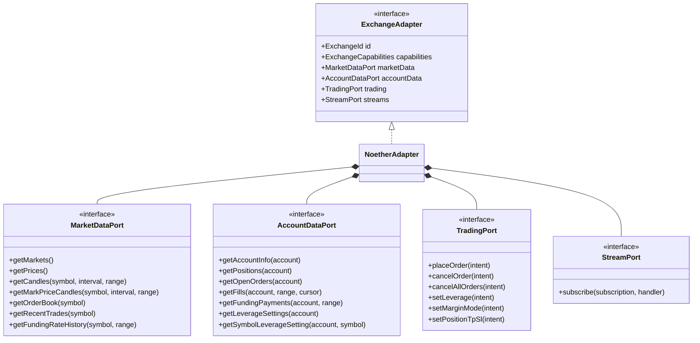
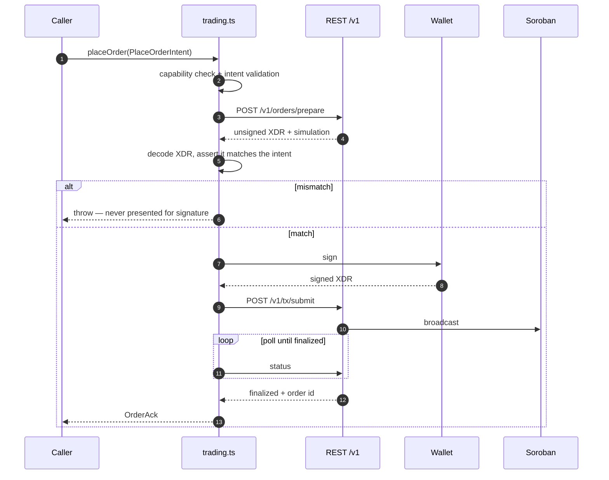
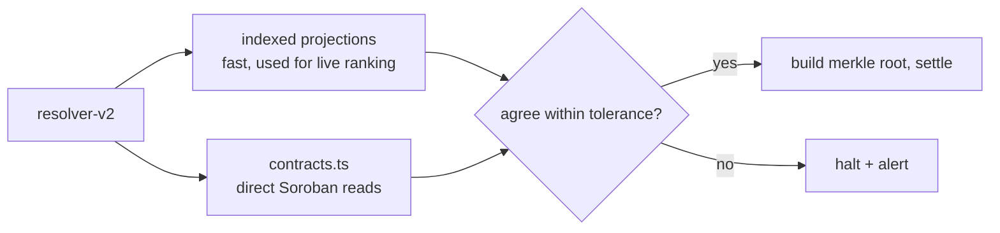

# `@repo/noether-sdk` — Noether Protocol Adapter

The Stellar trading venue for TradeFighters. A TypeScript package implementing
the `@repo/exchange-core` port interfaces against
[Noether](https://docs.noether.exchange), a perpetual futures protocol built on
Soroban.

It follows the same structure as the Pacifica and Hyperliquid SDKs already in
the monorepo, which means the application code that consumes it needs no
Stellar-specific branches.

---

## Package shape

```
packages/noether-sdk/src/
├── client.ts            # REST client for /v1
├── streams.ts           # WebSocket client: ticks, trades, account events
├── trading.ts           # TradingPort: prepare-sign-submit orchestration
├── auth.ts              # wallet challenge -> session -> API key provisioning
├── normalize.ts         # wire formats -> unified domain types
├── capabilities.ts      # the frozen ExchangeCapabilities descriptor
├── contracts.ts         # direct Soroban reads for settlement verification
├── noether-adapter.ts   # composite ExchangeAdapter
└── index.ts
```

Mirroring `@repo/hyperliquid-sdk` deliberately: one place to look when
debugging, one review pattern, and the normalization discipline is enforced by
familiarity rather than by documentation.

## Ports implemented



### REST surface

Noether exposes `/v1` groups for markets, oracle, accounts, positions, trading,
vaults, and referral. The client wraps them with the conventions the other SDKs
use: typed responses, retry with backoff on transient failures, rate-limit
etiquette, and pagination handled internally so callers see whole ranges.

`getFills` is the exception — it exposes cursor pagination, because the
resolver needs to walk long windows page by page and merge across venues.
Cursors are opaque and venue-specific, exactly as the port contract specifies.

### Normalization contract

Every response crosses into unified types at the client edge, once:

| Convention | Rule |
| --- | --- |
| Amounts | decimal strings, never floats |
| Timestamps | epoch milliseconds |
| Symbols | venue-scoped; compare as `(exchange, symbol)` |
| Sides / statuses | mapped to unified enums, unknown values throw rather than pass through |
| Errors | mapped to `exchange-core` typed errors |

Nothing downstream should ever need to know a Noether wire field name.

---

## Capability descriptor

The adapter publishes a frozen descriptor; application code branches on flags,
never on the venue name. Values are confirmed against Noether's contracts and
API during tranche 1 — several are unknown until the integration is running,
and the descriptor is where that uncertainty is made explicit rather than
buried in conditionals.

```ts
export const NOETHER_CAPABILITIES: ExchangeCapabilities = Object.freeze({
  id: 'noether',
  displayName: 'Noether',
  chainType: 'stellar',
  // TP/SL, ladder support, trigger types, slippage control, candle caps,
  // and fill-history depth are set from the protocol's actual behaviour
  // during the adapter build, not assumed here.
});
```

Three flags matter most downstream:

- `supportsTpSlLadder` gates whether the UI offers multi-rung exits or caps at
  one TP and one SL. Getting this wrong produces transactions that revert.
- `hasMarkPriceCandles` decides whether the resolver scores against mark-price
  candles or falls back to trade candles.
- `fillHistoryDepth` tells the resolver whether a competition window is fully
  covered by available history, or predates the retention horizon and must be
  flagged.

`ExchangeChainType` gains `'stellar'` alongside `'solana'` and `'evm'`, which
is what selects the Stellar address as the trading identity and the XDR signing
scheme.

---

## Trading: prepare, sign, submit



The decode-and-assert step is a hard requirement. A prepared transaction is
untrusted input until the adapter has confirmed the invoked contract, market,
side, size, and price bounds match what the user asked for. Mismatch fails
closed.

Cancels, leverage changes, margin-mode changes, and TP/SL edits use the same
shape. `setPositionTpSl` is diff-and-apply: it compares the requested ladder to
the resting exits and issues only the necessary places and cancels — or, where
the capability descriptor says the venue holds one exit per direction, replaces
the single slot.

---

## Authentication

One signing ceremony covers everything. See
[ONBOARDING.md](ONBOARDING.md#authentication) for the full sequence — from the
adapter's side, `auth.ts` requests a challenge for the user's Stellar address,
has the wallet sign it, and exchanges the signature for a Noether API key that
is scoped to read and prepare, never to move funds.

---

## Streams

The WebSocket client reuses the realtime resilience layer built for the
existing venues, because "connected but silent" is the failure mode that
actually breaks live rankings:

- **Staleness watchdog** — if no message arrives within the channel's expected
  cadence, the connection is considered dead regardless of socket state, and is
  torn down and rebuilt.
- **Wake recovery** — a browser resuming from sleep resubscribes rather than
  trusting a socket that survived suspension.
- **Infinite reconnect** with exponential backoff and jitter; the client never
  gives up on a live competition.
- **Snapshot on reconnect** — the first event after a reconnect is flagged
  `isSnapshot: true` so consumers replace state instead of appending to a
  series with a hole in it.
- **Stale-data badge** — when ticks age past threshold the UI says so, rather
  than showing a confidently wrong price.

Subscriptions are refcounted over one multiplexed upstream connection, matching
the `StreamPort` contract.

---

## Settlement reads

`contracts.ts` is the piece with no equivalent in the other SDKs. It reads
Soroban directly — the market contract and the SEP-40 oracle shim — so the
resolver can verify final PnL against on-chain state instead of trusting the
indexed projection it used for the live leaderboard.



This mirrors Noether's own reconciliation model, and it is the reason
competition results can be described as settled from on-chain truth rather than
from our database.

---

## Testing

| Layer | Approach |
| --- | --- |
| Normalization | recorded fixtures of real responses into unified types, including malformed and unknown-enum cases |
| Trading | prepare/sign/submit against a mocked venue, including the mismatched-XDR rejection path |
| Streams | simulated drops, silent sockets, and wake events; assert snapshot replay and watchdog firing |
| Capabilities | descriptor asserted against live venue behaviour in an integration test |
| Resolver parity | Noether fills feed the existing resolver suite; the multi-venue merged-replay proof must stay green |

The last row is the important one. The resolver suite is the regression net for
anything that touches how competitions are scored, and it stays green through
this integration or the integration is not done.
