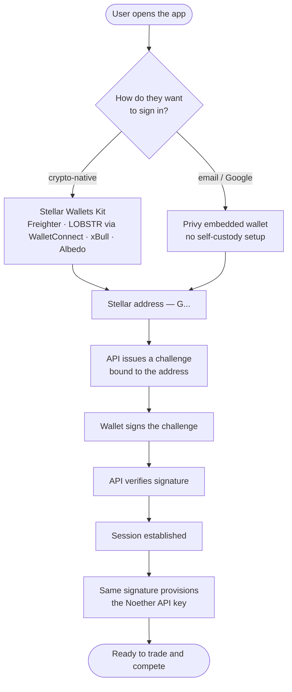
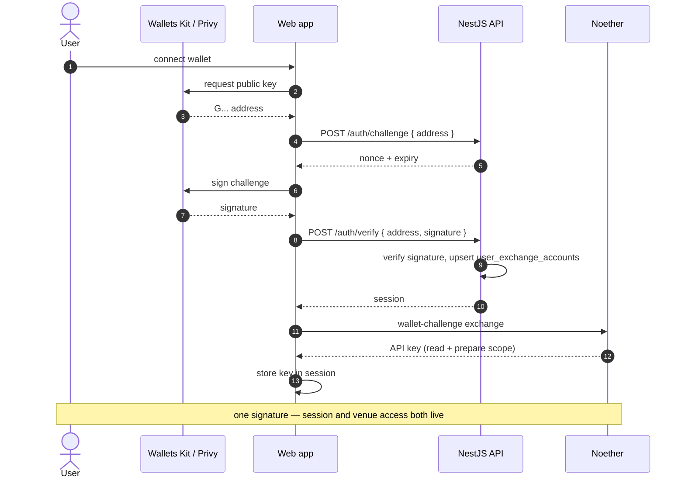
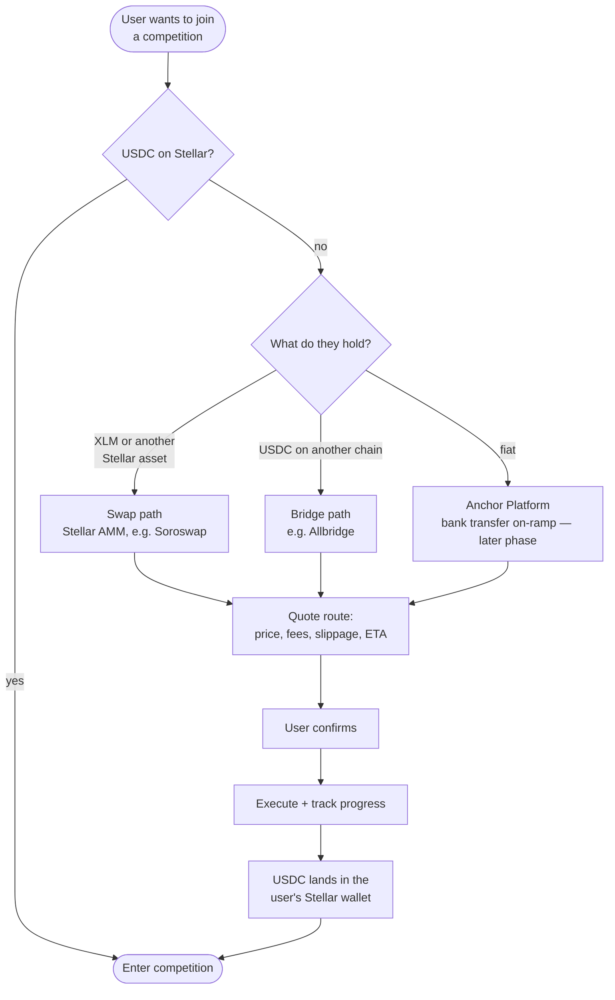
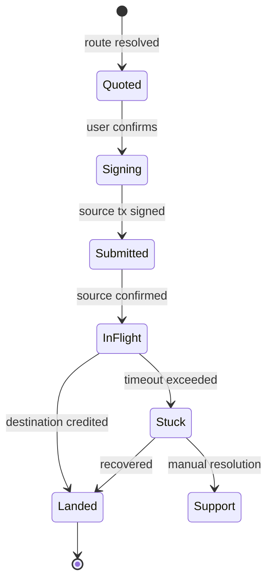

# Onboarding: Wallets, Auth, and Funding

Two barriers stand between a Stellar user and their first competition: getting
signed in, and getting USDC into the wallet they signed in with. This document
covers both.

---

## Authentication

TradeFighters already runs dual-auth — external wallets for crypto-native users
and Privy embedded wallets for people who sign up with an email address. Stellar
extends both paths rather than replacing either.

The point of the last two steps: **one signing ceremony**. The challenge
signature that establishes the session is also what provisions the Noether API
key through the venue's wallet-challenge flow. The user is not asked to sign
twice for what feels to them like one action.

The API key is scoped to reads and order preparation. It cannot move funds —
every state-changing transaction still requires a fresh wallet signature over
the prepared XDR.

### Sequence

Challenges carry a nonce and a short expiry, and are single-use, so a captured
signature cannot be replayed into a new session.

### Identity storage

`user_exchange_accounts` is the canonical `(user, exchange) → tradingAddress`
table already in production. Stellar rows carry the `G...` address and an
`is_initialized` flag, exactly like the Solana and EVM rows. A user may hold
identities on several venues at once and compete on whichever their competition
allows.

---

## Funding

The biggest funnel drop-off is not signup — it is a user who wants to join a
battle and holds no USDC on Stellar. The answer is to integrate proven
infrastructure rather than write custody-critical bridge code.

All three routes sit behind **one deposit widget**. The user picks an amount
and a source; the widget resolves the route, shows the all-in cost, and tracks
progress to completion. They never choose a bridge provider by name.

### Bridge integration

The monorepo already has `@repo/bridge-core` — the bridge analogue of
`exchange-core`. It defines bridgeable chains, unified quote/transfer/step
types, per-provider capability descriptors, and a `BridgePort` interface that
every provider adapter implements, with signing injected at the API composition
root.

Stellar integration is therefore additive in the same way the trading side is:

| Change | Where |
| --- | --- |
| add `'stellar'` to `BRIDGE_CHAIN_IDS` | `@repo/bridge-core/chain.ts` |
| add a `'stellar'` chain family | `@repo/bridge-core/chain.ts` |
| new provider adapter implementing `BridgePort` | `packages/allbridge-adapter` |
| swap provider behind the same widget | `packages/soroswap-adapter` |

The swap path is not a bridge and does not pretend to be one — it is a separate
provider with its own capability descriptor, surfaced through the same widget
because to the user both answer the same question.

### Progress tracking

Bridges are asynchronous and multi-step, so the widget models them as steps
rather than a spinner:

State is persisted, so closing the tab does not lose the transfer, and a `Stuck`
transfer surfaces with the provider's own recovery path rather than silently
disappearing.

### Rollout

The swap path ships fully functional against testnet liquidity. The bridge path
is implemented and demonstrated against the providers' supported environments
and gated behind a feature flag until mainnet, since bridges have no meaningful
testnet story. Fiat on-ramp via Anchor Platform is scoped after mainnet launch.

---

## Why this matters for the ecosystem

Every funded Stellar account created through this flow is a new Stellar user,
and every bridged transfer is USDC arriving from another ecosystem. The
competition is the reason to come; the deposit widget is what makes coming
possible in one sitting rather than three tabs and a support ticket.
