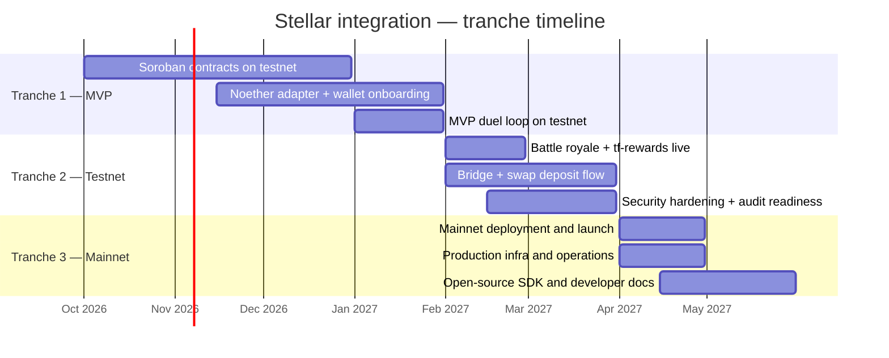
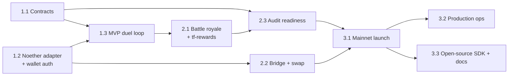

# Roadmap

Deliverables for the Stellar Community Fund Build award, organized into three
tranches: MVP, Testnet, Mainnet. Each deliverable states how completion is
measured, because "done" should be something a reviewer can check rather than
something we assert.

---

## Tranche 1 — MVP

### 1.1 Soroban contracts: competition escrow + referral rewards

Implement `tf-competition` (1v1 duel and battle royale escrow with merkle-based
prize claims) and `tf-rewards` (referral bindings, fee-share accrual,
permissionless claims) in Rust/Soroban, scaffolded with Scaffold Stellar, with
typed TypeScript clients generated for the web app and API.

**Completion:** public GitHub repository with both contracts deployed to
Stellar testnet; full unit and integration suites — create/join/cancel/settle,
merkle claim verification, double-claim prevention, referral accrual and claim
paths — passing in CI; generated TS clients published in the monorepo.

**Target:** December 2026 · **Budget:** $16,400

### 1.2 Noether adapter + Stellar wallet onboarding

Ship `@repo/noether-sdk` implementing the `exchange-core` port interfaces —
REST and WebSocket clients, prepare–sign–submit order flow, wallet-challenge
API-key provisioning — and integrate Stellar Wallets Kit into the web app
alongside the existing auth system.

**Completion:** from the TradeFighters UI, a user can connect a Stellar wallet
(e.g. Freighter), authenticate, and open and close a position on Noether
testnet end-to-end, with the transaction visible on a Stellar testnet explorer;
adapter test suite passing in CI.

**Target:** January 2027 · **Budget:** $12,800

### 1.3 MVP competition loop on testnet

Wire the pieces into the full product loop: create a 1v1 duel with test USDC
escrowed in `tf-competition`, both players trade on Noether testnet, and the
resolver settles the outcome on-chain from reconciled position data.

**Completion:** a deployed staging environment plus a recorded demo showing a
complete duel — creation, join, trading, on-chain settlement, and winner payout
verifiable on a Stellar testnet explorer.

**Target:** January 2027 · **Budget:** $9,600

---

## Tranche 2 — Testnet

### 2.1 Battle royale + referral rewards live on public testnet

Extend the testnet deployment to multi-player battle royales — entry fees,
power-law prize curve, merkle settlement, individual claims — and activate the
`tf-rewards` flow so referrers accrue and claim their share of platform fees
and Noether referral earnings.

**Completion:** a publicly accessible testnet deployment where any user can
join a battle royale, and where completed battles show merkle-root settlement,
prize claims, and referral reward claims verifiable on a Stellar testnet
explorer.

**Target:** February 2027 · **Budget:** $13,600

### 2.2 Bridge + swap deposit flow

Integrate an existing bridge (e.g. Allbridge) and a Stellar AMM (e.g. Soroswap)
behind a unified deposit widget so users can fund their Stellar wallet with
USDC from other chains or by swapping Stellar assets, with route quoting and
progress tracking.

**Completion:** the deposit widget is live in the testnet app with the swap
path fully functional against testnet liquidity and the bridge path implemented
and demonstrated against the providers' supported environments, gated behind a
feature flag ready for mainnet.

**Target:** March 2027 · **Budget:** $11,200

### 2.3 Security hardening and audit readiness

Prepare the contracts for the LaunchKit audit: property-based and fuzz testing
on escrow and claim paths, an internal adversarial review covering reentrancy
patterns, arithmetic edge cases, and authorization on every entrypoint;
monitoring and alerting on contract events; and a complete audit documentation
pack with specs, invariants, and threat model.

**Completion:** published audit-readiness pack in the repository; test coverage
report for both contracts; monitoring dashboard operational against testnet;
audit submitted through Stellar LaunchKit.

**Target:** March 2027 · **Budget:** $7,800

---

## Tranche 3 — Mainnet

### 3.1 Mainnet deployment and launch

Remediate audit findings, deploy `tf-competition` and `tf-rewards` to Stellar
mainnet with USDC, publish them via Stellar Registry, and open competitions to
real users — with Noether trading enabled in lockstep with the protocol's own
mainnet availability.

**Completion:** contract addresses live and verifiable on Stellar mainnet;
audit report and remediations published; first real-stakes competitions
created, settled, and claimed on mainnet.

**Target:** April 2027 · **Budget:** $11,400

### 3.2 Production infrastructure and operations

Production-grade Soroban RPC and Horizon setup, event ingestion with replay and
recovery, resolver redundancy, on-call alerting, and operational runbooks for
settlement incidents and contract upgrades.

**Completion:** production environment live with monitoring dashboards;
documented runbooks in the repository; demonstrated recovery of the event
indexer from a forced restart without state loss.

**Target:** April 2027 · **Budget:** $8,200

### 3.3 Open-source SDK and developer documentation

Release the Noether adapter and the generated contract clients as documented
open-source packages, plus integration guides, so other Stellar builders can
reuse the trading adapter and instantiate the competition and rewards contracts
from the Stellar Registry.

**Completion:** packages published on npm under an open-source license;
developer documentation covering the adapter, both contracts, and a
quick-start; example integration repository available.

**Target:** May 2027 · **Budget:** $6,600

---

## Budget summary

| Tranche | Amount |
| --- | ---: |
| 1 — MVP | $38,800 |
| 2 — Testnet | $32,600 |
| 3 — Mainnet | $26,200 |
| **Total** | **$97,600** |

Requested in XLM, covering two full-time engineers for approximately six months
plus testnet and production infrastructure costs tied directly to the
deliverables above. No marketing, promotion, prize pools, or audit costs are
included — the audit is expected through the LaunchKit credits unlocked at the
Testnet tranche.

---

## Dependency notes

Noether is on testnet at the time of writing. Tranche 1 and 2 work against
testnet throughout, which is where it needs to be regardless. Tranche 3.1
scopes mainnet trading as enabled *in lockstep with Noether's own mainnet
availability* — the escrow, rewards, onboarding, and settlement layers do not
depend on it and reach mainnet on our own schedule.

## Dependency graph

Contracts and adapter are independent, so the two engineers work in parallel
through tranche 1 and converge on the duel loop.
