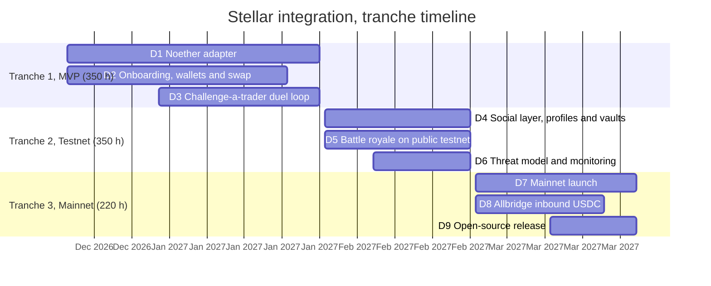

# Roadmap

Deliverables for our Stellar Community Fund Build Award (SCF #46, Integration
Track), in three tranches: MVP, Testnet, Mainnet. Each deliverable states how
completion is measured, so that "done" is something a reviewer can check.

Total: 920 engineering hours at a blended $90/h, $82,800, requested in XLM.
Already built and excluded from the budget: the `tf-competition` 1v1 duel
escrow on testnet (create, join, cancel, settle), described in the
[README](../README.md#testnet-deployment).

Dates assume an award in mid-December 2026. Two engineers full time (about
80 hours a week combined), led by Jérémie Lucotte.

---

## Tranche 1, MVP (January 2027): $31,500, 350 h

### D1. Noether adapter ($10,800, 120 h)

REST and WebSocket clients, the prepare, sign, submit order flow,
wallet-challenge API keys, position reconciliation against Noether's market
contract. Details: [NOETHER-ADAPTER.md](NOETHER-ADAPTER.md).

**Completion:** from the TradeFighters UI a user opens and closes a position on
Noether testnet; transaction hashes published; adapter tests pass in CI.

### D2. Stellar onboarding: wallets and swap to USDC ($11,700, 130 h)

- Stellar Wallets Kit for multi-wallet connection ($900)
- Freighter Connect for Soroban authorization entries on escrow joins
  (`signAuthEntry`), network mismatch detection and account change handling
  ($4,000)
- Privy embedded Stellar wallets ($1,400)
- Soroswap Routing API to swap XLM or other Stellar assets into USDC in the
  deposit widget ($5,400)

**Completion:** a user signs in with xBull or LOBSTR through Stellar Wallets
Kit, with Freighter, or by email through Privy; a Freighter user joins a
testnet duel by signing the contract authorization entry, transaction hash
published; the app blocks a join when Freighter is on the wrong network; an
XLM to USDC swap is executed from the app on testnet, transaction hash
published; recorded demo.

### D3. Challenge-a-trader duel loop on testnet ($9,000, 100 h)

`tf-competition` extended with duels addressed to a named Stellar account,
which only that account can accept, launched from the challenged trader's
profile. The resolver snapshots both players' Noether positions at start and
end and settles from reconciled PnL.

**Completion:** public staging app; recorded demo of a challenge sent from a
profile, accepted, traded, settled and paid out; settlement transactions
viewable on a testnet explorer; contract tests pass in CI.

---

## Tranche 2, Testnet (February 2027): $31,500, 350 h

### D4. Social layer: verified trader profiles and following a trader through Noether vaults ($15,300, 170 h)

- **Verified profiles ($7,200):** indexer of Noether trade events and
  `tf-competition` events for linked Stellar accounts, with replay from a given
  ledger; profile pages showing PnL, win record and duel history, each figure
  linked to its transaction.
- **Vault follow ($8,100):** vault discovery on trader profiles, ranking by
  onchain performance, deposit and withdraw flows signed by the user through
  Noether's vault contracts.

**Completion:** profiles live on the testnet app; for any figure shown, the
linked transaction opens on a testnet explorer; the indexer rebuilt from
scratch reproduces the same profiles. A test user deposits into and withdraws
from a trader's Noether vault on testnet, transaction hashes published; the
app holds no user funds at any point.

### D5. Battle royale on public testnet ($10,800, 120 h)

Entry fees, prize curve, merkle-root settlement, individual claims with
double-claim protection, players bound to the TradeFighters code in Noether's
referral registry.

**Completion:** anyone can join a testnet battle royale; settlement root,
claims and referral bindings viewable on a testnet explorer.

### D6. Threat model and monitoring plan ($5,400, 60 h)

STRIDE threat model with a dataflow diagram and trust boundaries (resolver key,
admin configuration, profile indexer integrity, vault deposit flow, embedded
wallet keys); an onchain monitoring plan mapping each high-severity threat to a
contract event and an alert; application security testing (property and fuzz
tests on escrow and claim paths). This is application security testing, not a
third-party audit; the audit is requested separately through the Soroban
Security Audit Bank.

**Completion:** documents published in this repository; alerting live on
testnet.

---

## Tranche 3, Mainnet (March 2027): $19,800, 220 h

### D7. Mainnet launch ($10,800, 120 h)

`tf-competition` deployed on Stellar mainnet with Circle USDC, source-verified
on StellarExpert, Noether mainnet as venue; production RPC, event indexer with
replay, runbooks; admin and treasury on multisig.

**Venue contingency:** the resolver reads PnL through an adapter, so if Noether
mainnet trading is not open within the tranche window, competitions run as spot
trading competitions on Aquarius.

**Completion:** contract IDs live and verified; first paid competitions settled
on mainnet with transaction hashes published.

### D8. Allbridge Core inbound USDC ($5,400, 60 h)

Bridge route in the deposit widget for USDC arriving from other chains.

**Completion:** bridge route quoted and executed on mainnet from at least one
source chain; transaction hashes published.

### D9. Open-source release ($3,600, 40 h)

Contracts, the Noether adapter and the profile indexer published under MIT
with documentation and an example integration.

**Completion:** npm package and docs live; example repository public.

### Final-tranche onchain metric

Release condition for tranche 3, measured over the 60 days after the first
mainnet competition, wallets controlled by the team excluded:

- **Metric:** $250,000 of cumulative trading volume on Noether attributed
  onchain to the TradeFighters referral code (`trade_recorded` events in
  Noether's referral registry).
- **Basis:** our builder and referral codes carried $3.13M of volume on Solana
  between April and August 2026, about $1.4M per 60 days. The
  threshold assumes about 18% of that pace moves to Stellar in the first 60
  days, conservative because traders must bring funds to Stellar and Noether's
  liquidity is new.
- **Fallback, only if Noether mainnet trading is not open when we launch on
  mainnet:** $2,500 of cumulative USDC entry fees settled through the
  `tf-competition` mainnet contract. Basis: our Solana escrow settled $3,490 of
  entry fees across 25 competitions between April and August 2026, about
  $1,550 per 60 days; the fallback asks for about 1.6 times that pace.
- **Footprint registered at award:** `tf-competition` contract ID, resolver and
  treasury accounts, the TradeFighters code in Noether's referral registry.
- **Tracked alongside, not release conditions:** deposits into Noether vaults
  made from our app, number of Stellar accounts with a verified profile.

---

## Not funded by the award

The social feed, live streams and wallet analytics, prizes, referral and
creator incentives, marketing and user acquisition, legal and entity costs,
and the security audit (Soroban Security Audit Bank).
